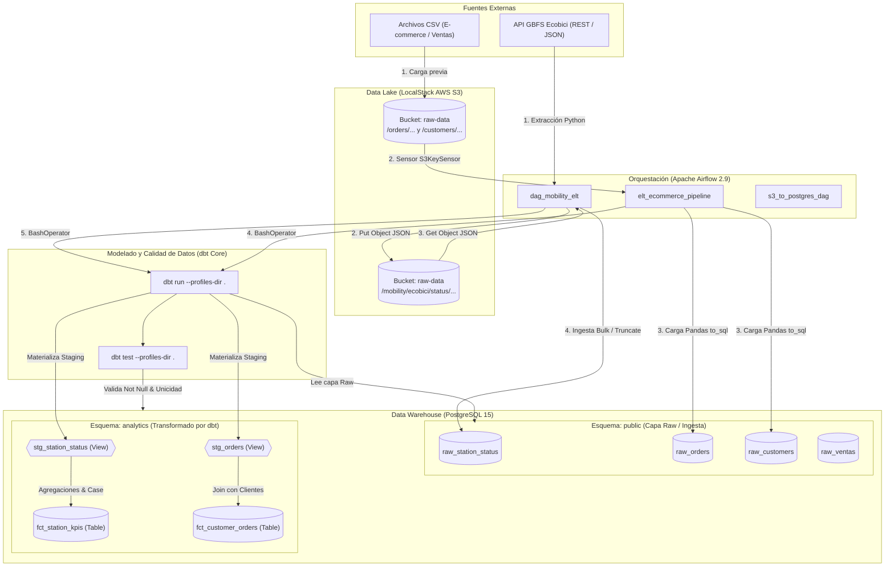
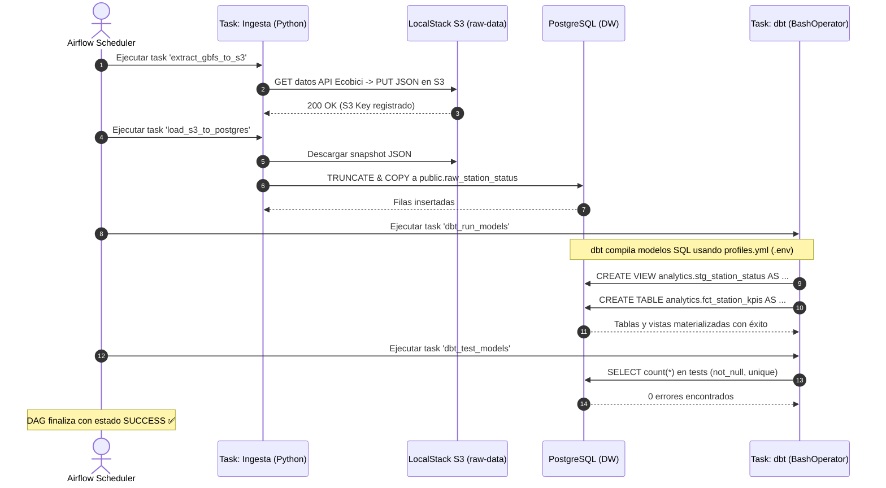
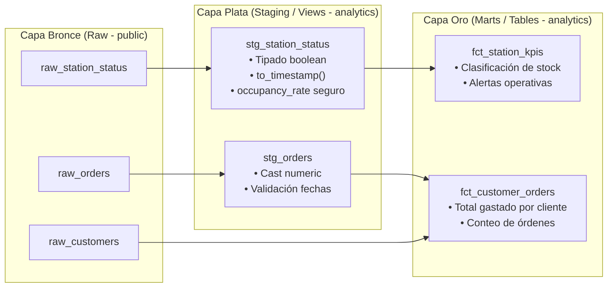

# Arquitectura de Datos y Flujo de Interacción: Airflow + S3 + dbt + PostgreSQL 📐

Este documento detalla la arquitectura técnica, la estructura modular del repositorio y el flujo de extremo a extremo (ELT) que conecta las fuentes de datos, el almacenamiento en objetos, la orquestación y el modelado analítico.

---

## 1. Arquitectura General del Sistema



---

## 2. Diagrama de Secuencia: Cómo interactúa Airflow con dbt

A continuación se muestra el ciclo de vida de una ejecución del pipeline `pipeline_movilidad_urbana_elt`:



---

## 3. Modelo de Capas dbt (Medallion Architecture)

El proyecto organiza las transformaciones en capas analíticas bien definidas:



---

## 4. Estructura Modular del Repositorio

```plaintext
labs_data_engineer/
│
├── .env.example                 # Plantilla pública de variables de entorno
├── .env                         # Secretos locales (ignorado en Git)
├── .gitignore                   # Exclusiones de Git (logs, target dbt, .env)
├── docker-compose.yaml          # Orquestación de contenedores parametrizada
├── README.md                    # Documentación operativa y credenciales
├── DIAGRAMS.md                  # Este documento con diagramas de flujo y arquitectura
│
├── dags/                        # Orquestación (Apache Airflow)
│   ├── dag_mobility_elt.py      # Pipeline producción: API -> S3 -> Postgres -> dbt
│   ├── elt_ecommerce_pipeline.py# Pipeline E-Commerce: Sensor S3 -> Postgres -> dbt
│   ├── s3_to_postgres_dag.py    # Pipeline incremental con UPSERT
│   └── test_s3_dag.py           # DAG de prueba y validación de S3
│
└── dbt_project/                 # Modelado y Calidad (dbt Core)
    ├── dbt_project.yml          # Configuración del proyecto y materializaciones
    ├── profiles.yml             # Perfil dinámico que lee variables con env_var()
    └── models/
        ├── staging/             # Capa de preparación y normalización
        │   ├── schema.yml       # Tests automatizados (not_null, unique)
        │   ├── stg_orders.sql
        │   └── stg_station_status.sql
        └── marts/               # Capa de negocio y reporting
            ├── fct_customer_orders.sql
            └── fct_station_kpis.sql
```


---

## 5. Arquitectura del Lakehouse Distribuido (Kafka + Spark + Delta Lake + Airflow + dbt + FastAPI)

Este diagrama representa la arquitectura integral del stack de datos: desde la ingesta de eventos en streaming, pasando por la capa Lakehouse con Delta Lake sobre S3, la curación distribuida con Apache Spark, hasta el modelado dimensional con dbt y la capa de observabilidad con FastAPI.

```mermaid
flowchart TD
    %% Estilos y Definiciones
    classDef producer fill:#312e81,stroke:#6366f1,stroke-width:2px,color:#ffffff;
    classDef streaming fill:#0f172a,stroke:#38bdf8,stroke-width:2px,color:#ffffff;
    classDef storage fill:#064e3b,stroke:#10b981,stroke-width:2px,color:#ffffff;
    classDef spark fill:#7c2d12,stroke:#f97316,stroke-width:2px,color:#ffffff;
    classDef warehouse fill:#1e1b4b,stroke:#818cf8,stroke-width:2px,color:#ffffff;
    classDef orchestration fill:#134e4a,stroke:#14b8a6,stroke-width:2px,color:#ffffff;
    classDef presentation fill:#4c1d95,stroke:#a855f7,stroke-width:2px,color:#ffffff;

    subgraph Origen ["1. Ingesta y Generación de Eventos"]
        PROD["reddit_producer.py<br/>(Requests + Confluent-Kafka)<br/>• Extracción REST JSON<br/>• Normalización & Metadatos"]:::producer
    end

    subgraph KafkaCluster ["2. Bus de Mensajería Distribuido (Kafka KRaft)"]
        KAFKA[("kafka:9092 / host:29092<br/>Tópico: reddit_posts_stream<br/>• Particiones: 3<br/>• Replication Factor: 1")]:::streaming
        KAFKA_UI["Kafka UI (Port: 8082)<br/>• Inspección de Tópicos & Offsets"]:::streaming
        KAFKA -.->|AdminClient & Telemetría| KAFKA_UI
    end

    subgraph SparkCluster ["3. Procesamiento Distribuido (Apache Spark 3.5.1)"]
        SPARK_MASTER["spark-master (Port: 7077 / UI: 8081)"]:::spark
        SPARK_WORKER["spark-worker (2 Cores, 2GB RAM)"]:::spark
        SPARK_MASTER --- SPARK_WORKER

        SPARK_STREAM["Job 1: stream_reddit_to_delta.py<br/>• Structured Streaming<br/>• Micro-lotes cada 15s<br/>• Parseo Schema JSON"]:::spark
        SPARK_BATCH["Job 2: batch_aggregate_reddit.py<br/>• Deduplicación Global por Contenido<br/>• Agregación KPIs por Subreddit<br/>• Vacuum (168h)"]:::spark
    end

    subgraph LakehouseStorage ["4. Almacenamiento Lakehouse (LocalStack S3 + Delta Lake)"]
        S3[("LocalStack S3 (Port: 4566)<br/>Bucket: raw-data")]:::storage
        DELTA["Delta Lake Table<br/>s3a://raw-data/delta/reddit_posts/<br/>• Transacciones ACID (_delta_log)<br/>• Particionado por ingestion_date<br/>• Parquet + Snappy"]:::storage
        CHECKPOINT["Checkpoints S3<br/>s3a://raw-data/checkpoints/reddit_posts/"]:::storage
        S3 --- DELTA
        S3 --- CHECKPOINT
    end

    subgraph Warehouse ["5. Data Warehouse (PostgreSQL 15 :5433)"]
        PG_KPIS[("public.reddit_subreddit_kpis<br/>• Total posts únicos, score promedio,<br/>comentarios, upvote ratio")]:::warehouse
        PG_ARTICLES[("public.reddit_articles<br/>• Publicaciones y relatos curados<br/>• Texto completo sin duplicados")]:::warehouse
        PG_AIRFLOW[("airflow (Metastore DB)")]:::warehouse
    end

    subgraph Orchestration ["6. Orquestación y Transformaciones (Airflow + dbt)"]
        AIRFLOW["Apache Airflow 2.9 (Port: 8888)<br/>• Webserver & Scheduler<br/>• Conexiones: aws_default, spark_default, postgres"]:::orchestration
        DAG_SPARK["DAG: dag_reddit_lakehouse_batch<br/>• SparkSubmitOperator"]:::orchestration
        DBT["dbt Core (dbt-postgres)<br/>• Modelado Staging & Marts<br/>• Data Tests (not_null, unique)"]:::orchestration
        AIRFLOW --- DAG_SPARK
        AIRFLOW --- DBT
    end

    subgraph Presentation ["7. Capa de Observabilidad y Consumo (FastAPI + Web UI)"]
        API["FastAPI Observability API (Port: 8000)<br/>api/main.py<br/>• GET /health<br/>• GET /metrics/summary<br/>• GET /api/articles<br/>• GET /metrics/delta"]:::presentation
        DASHBOARD["Dashboard Web Live (Tailwind + Lucide)<br/>• KPIs en tiempo real<br/>• Lectura de publicaciones completas<br/>• Memoria de estado sin cortes"]:::presentation
        API --- DASHBOARD
    end

    %% Relaciones y Flujos de Datos
    PROD -->|1. Produce Eventos JSON| KAFKA
    KAFKA -->|2. Ingesta Streaming Real-Time| SPARK_STREAM
    SPARK_STREAM -->|3. Escritura Micro-lotes S3A| DELTA
    SPARK_STREAM -.->|Estado del Stream| CHECKPOINT

    DAG_SPARK -.->|4. Dispara Job Batch Periódico| SPARK_BATCH
    DELTA -->|5. Lectura Distribuida Delta Lake| SPARK_BATCH
    SPARK_BATCH -->|6. Carga JDBC (Overwrite)| PG_KPIS
    SPARK_BATCH -->|6. Carga JDBC Deduplicada| PG_ARTICLES

    AIRFLOW -.->|7. Dispara dbt run & dbt test| DBT
    DBT -->|8. Modelado SQL sobre DW| Warehouse

    PG_KPIS -->|9. Consulta SQL KPIs| API
    PG_ARTICLES -->|9. Consulta SQL Artículos| API
    DELTA -->|10. Inspección directa PyArrow / deltalake| API
```

---

## 6. Resumen de Flujos y Protocolos de Conexión

| Origen | Destino | Protocolo / Librería | Tipo de Flujo | Descripción |
| :--- | :--- | :--- | :--- | :--- |
| **reddit_producer.py** | **Apache Kafka** | `kafka://kafka:9092` (`confluent-kafka`) | Streaming Continuo | Publicación de eventos en tiempo real al tópico `reddit_posts_stream`. |
| **Apache Kafka** | **Spark Master / Worker** | `spark-sql-kafka-0-10` | Structured Streaming | Lectura de mensajes particionados con checkpointing. |
| **PySpark Streaming** | **LocalStack S3 (Delta)** | `s3a://` (`hadoop-aws`, `delta-spark`) | Micro-batches (15s) | Escritura ACID en Parquet particionado por `ingestion_date`. |
| **Apache Airflow** | **Spark Master** | `SparkSubmitOperator` | Orquestación Batch | Ejecución periódica programada de agregaciones y deduplicación. |
| **PySpark Batch** | **LocalStack S3 (Delta)** | `s3a://` (`delta.tables`) | Batch Lectura | Lectura masiva de snapshots Delta y ejecución de `vacuum`. |
| **PySpark Batch** | **PostgreSQL (DW)** | JDBC (`org.postgresql.Driver`) | Batch Escritura | Carga consolidada en `public.reddit_subreddit_kpis` y `public.reddit_articles`. |
| **Airflow** | **dbt Core** | `BashOperator` (`dbt run`, `dbt test`) | Transformación ELT | Modelado dimensional de tablas staging y marts con perfiles parametrizados. |
| **FastAPI Backend** | **PostgreSQL & S3** | SQLAlchemy & `deltalake` (PyArrow) | API REST & Web UI | Exposición de métricas, salud de servicios y renderizado de artículos en el Dashboard. |
