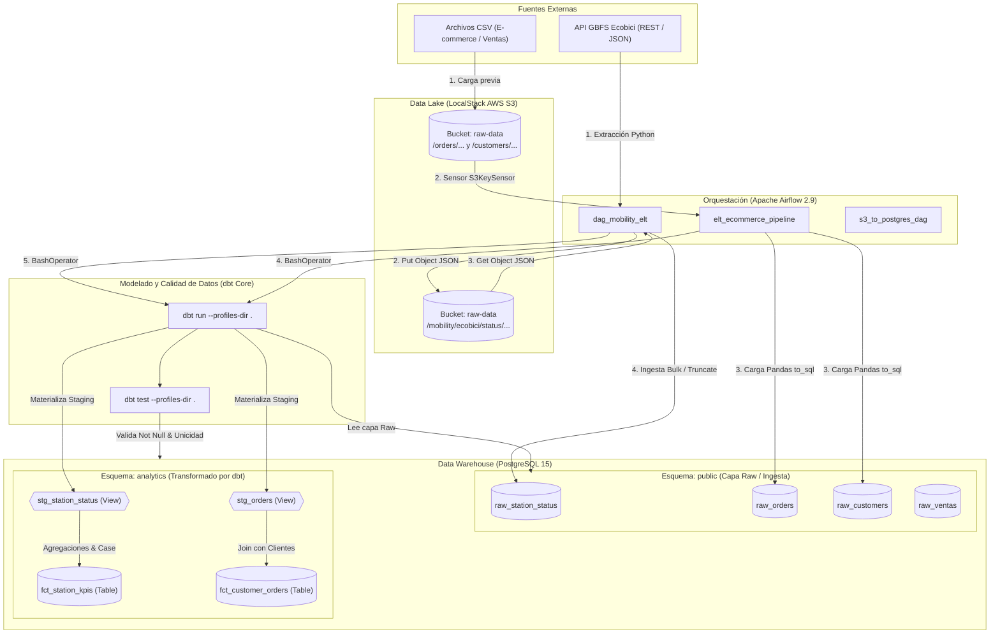
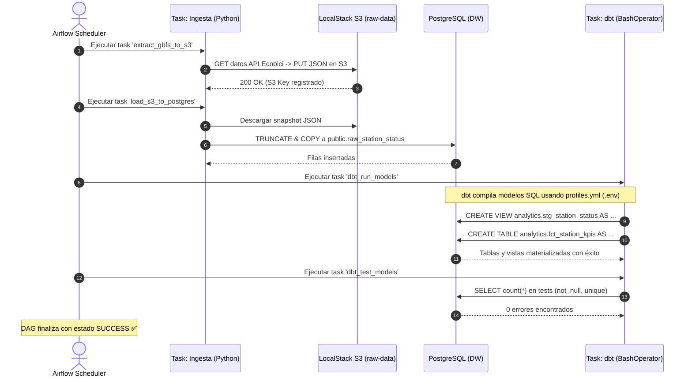
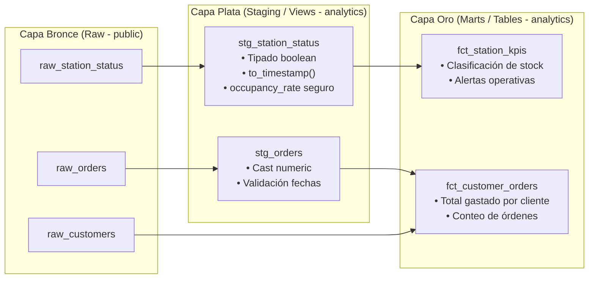

# Arquitectura de Datos y Flujo de Interacción: Airflow + S3 + dbt + PostgreSQL 📐

Este documento detalla la arquitectura técnica, la estructura modular del repositorio y el flujo de extremo a extremo (ELT) que conecta las fuentes de datos, el almacenamiento en objetos, la orquestación y el modelado analítico.

---

## 1. Arquitectura General del Sistema



---

## 2. Diagrama de Secuencia: Cómo interactúa Airflow con dbt

A continuación se muestra el ciclo de vida de una ejecución del pipeline `pipeline_movilidad_urbana_elt`:



---

## 3. Modelo de Capas dbt (Medallion Architecture)

El proyecto organiza las transformaciones en capas analíticas bien definidas:



---

## 4. Estructura Modular del Repositorio

```plaintext
labs_data_engineer/
│
├── .env.example                 # Plantilla pública de variables de entorno
├── .env                         # Secretos locales (ignorado en Git)
├── .gitignore                   # Exclusiones de Git (logs, target dbt, .env)
├── docker-compose.yaml          # Orquestación de contenedores parametrizada
├── README.md                    # Documentación operativa y credenciales
├── DIAGRAMS.md                  # Este documento con diagramas de flujo y arquitectura
│
├── dags/                        # Orquestación (Apache Airflow)
│   ├── dag_mobility_elt.py      # Pipeline producción: API -> S3 -> Postgres -> dbt
│   ├── elt_ecommerce_pipeline.py# Pipeline E-Commerce: Sensor S3 -> Postgres -> dbt
│   ├── s3_to_postgres_dag.py    # Pipeline incremental con UPSERT
│   └── test_s3_dag.py           # DAG de prueba y validación de S3
│
└── dbt_project/                 # Modelado y Calidad (dbt Core)
    ├── dbt_project.yml          # Configuración del proyecto y materializaciones
    ├── profiles.yml             # Perfil dinámico que lee variables con env_var()
    └── models/
        ├── staging/             # Capa de preparación y normalización
        │   ├── schema.yml       # Tests automatizados (not_null, unique)
        │   ├── stg_orders.sql
        │   └── stg_station_status.sql
        └── marts/               # Capa de negocio y reporting
            ├── fct_customer_orders.sql
            └── fct_station_kpis.sql
```
